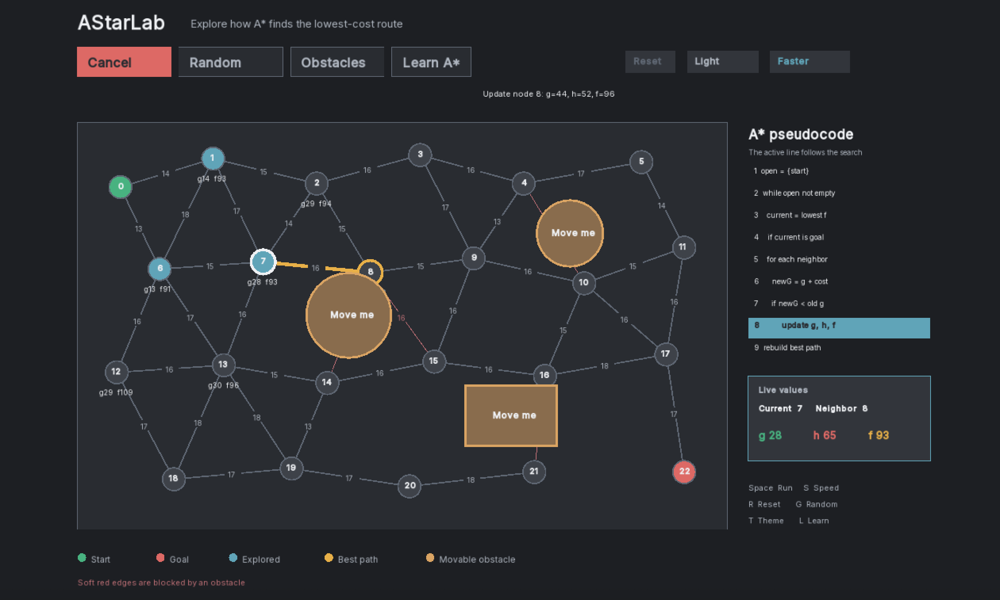

# AStarLab

AStarLab is an interactive, educational A* visualizer written in modern C++ with SFML. It demonstrates A* on a weighted roadmap whose edges can be blocked by movable geometric obstacles.

Use it as a native desktop application or in a browser. The deployed website runs the same C++ graph and A* search engine through WebAssembly, while retaining a JavaScript fallback for local development.

## Preview



## Features

- Explicit graph nodes and weighted edges
- Numeric edge costs and an admissible Euclidean heuristic
- Animated node expansion and final lowest-cost path
- Visible `g`, `h`, and `f = g + h` values during the search
- Draggable circular and rectangular obstacles
- Live edge-obstacle collision detection
- Randomized node positions and edge costs on a stable, connected topology
- Four-part in-app **Learn A*** guide
- Tools for adding and deleting circular or rectangular obstacles
- Dark mode by default, with an optional light theme
- Slow educational playback by default, with an optional normal speed
- Resizable and maximizable window with proportional responsive scaling
- Final path cost and expanded-node statistics
- Side-by-side pseudocode that highlights the line currently running
- Live current-node, neighbor, and `g`, `h`, `f` values synchronized with the search
- Cancel control during playback, with graph and obstacle editing locked until cancellation
- Unit tests for reachable, blocked, and detour scenarios
- Cross-platform CMake project for macOS, Windows, and Linux
- Browser version powered by the shared C++ engine compiled to WebAssembly

## Controls

| Action | Mouse / keyboard |
| --- | --- |
| Move an obstacle | Left-drag a circle or rectangle |
| Run or cancel A* | `Space`, `Enter`, or **Run/Cancel** |
| Restore the demonstration | `R` or **Reset** |
| Randomize nodes and costs | `G` or **Random** |
| Add a circular obstacle | Open **Obstacles**, choose **Add circle**, then click the graph |
| Add a rectangular obstacle | Open **Obstacles**, choose **Add rectangle**, then click the graph |
| Delete an obstacle | Open **Obstacles**, choose **Delete obstacle**, or right-click it |
| Open the A* lessons | `L` or **Learn A*** |
| Change lesson page | `Left` / `Right` arrow or the lesson buttons |
| Toggle light/dark mode | `T` or the compact **Light/Dark** control |
| Change playback speed | `S` or the compact **Faster/Slower** control |

## Build and run

Requirements: CMake 3.28+, a C++17 compiler, Git, and an internet connection for the first build. CMake downloads SFML 3.1.0 automatically.

```sh
cmake -S . -B build -DCMAKE_BUILD_TYPE=Release
cmake --build build --config Release
```

On macOS:

```sh
open build/AStarLab.app
```

You can also run the executable directly:

```sh
./build/AStarLab.app/Contents/MacOS/AStarLab
```

On Windows, use the generated executable in `build/Release/`.

## Browser version

The browser interface is a static site in `web/`. It works directly with its JavaScript fallback; production deployment compiles the existing C++ search core to WebAssembly with Emscripten.

Serve it locally from the project root:

```sh
python3 -m http.server 8080
```

Then open `http://localhost:8080/web/`.

To build the WebAssembly core locally, install Emscripten and run:

```sh
emcmake cmake -S web -B build-web -DCMAKE_BUILD_TYPE=Release
cmake --build build-web
mkdir -p web/generated
cp build-web/astar-core.js build-web/astar-core.wasm web/generated/
```

The included GitHub Pages workflow builds and deploys the browser lab after every push to `main`.

## Run the tests

```sh
ctest --test-dir build --output-on-failure
```

## Project structure

```text
include/       Public C++ headers
src/           Weighted graph, A* engine, collision logic, and SFML application
tests/         Algorithm tests that run without opening a window
web/           Responsive browser UI and WebAssembly bridge
CMakeLists.txt Cross-platform build configuration
```

## What the visualization teaches

- `g(n)` is the known path cost from the start to node `n`.
- `h(n)` is the straight-line estimate from `n` to the goal, scaled to the same units as the edges.
- `f(n) = g(n) + h(n)` estimates the total route cost through `n`.
- A* repeatedly expands the frontier node with the smallest `f` value.
- Obstacles disable any graph edge they intersect. Moving an obstacle changes the available graph, so rerunning A* may produce a different optimal route.

