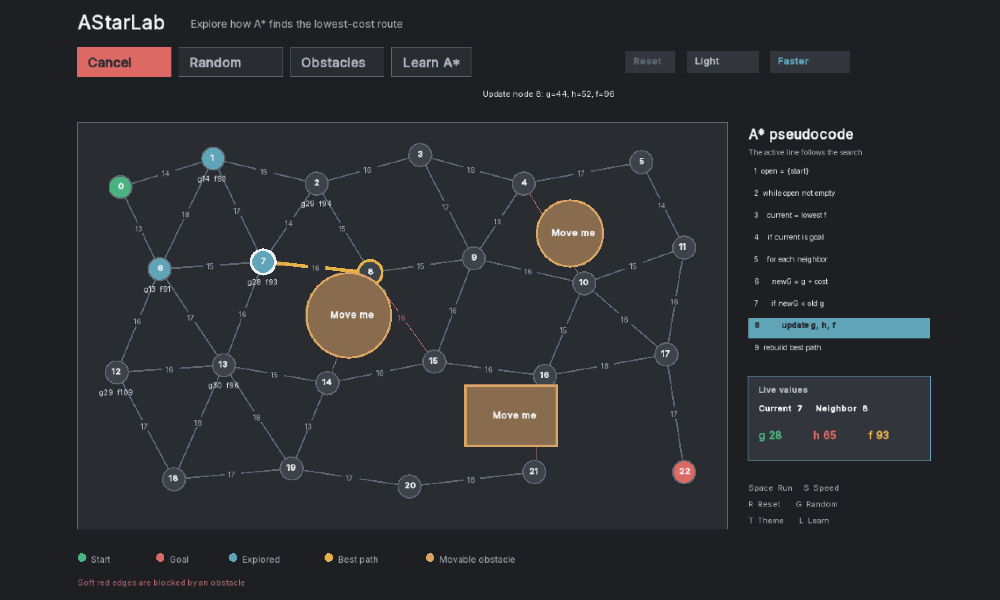

# AStarLab

AStarLab is an interactive, educational A* visualizer written in modern C++ with SFML. It demonstrates A* on a weighted roadmap whose edges can be blocked by movable geometric obstacles.

Use it as a native desktop application or in a browser. The deployed website runs the same C++ graph and A* search engine through WebAssembly, while retaining a JavaScript fallback for local development.

**▶ Try it in your browser: [icarkyawheintun.github.io/AStarLab](https://icarkyawheintun.github.io/AStarLab/)** (no install needed)

## Preview



## Features

- Explicit graph nodes and weighted edges
- Numeric edge costs and an admissible Euclidean heuristic
- Animated node expansion and final lowest-cost path
- Visible `g`, `h`, and `f = g + h` values during the search
- Draggable circular and rectangular obstacles
- Live edge-obstacle collision detection
- Randomized node positions and edge costs on a stable, connected topology
- Four-part in-app **Learn A*** guide
- Tools for adding and deleting circular or rectangular obstacles
- Dark mode by default, with an optional light theme
- Step-by-step playback: play/pause, step forward and back, five speeds, by pseudocode line or by expanded node
- Resizable and maximizable window with proportional responsive scaling
- Final path cost and expanded-node statistics
- Side-by-side pseudocode that highlights the line currently running
- Live current-node, neighbor, and `g`, `h`, `f` values synchronized with the search
- Open set drawn on the graph and listed in priority order; predict mode; four search strategies with a comparison table; five auto-checked challenges; selectable start and goal
- Unit tests for reachable, blocked, and detour scenarios
- Cross-platform CMake project for macOS, Windows, and Linux
- Browser version powered by the shared C++ engine compiled to WebAssembly

### Browser version extras

The browser version adds tools that turn watching into thinking:

- **Full playback control**: play/pause, step forward and **back**, restart, finish, a speed slider, and stepping by pseudocode line or by expanded node
- **Visible open set**: frontier nodes have dashed rings, every node shows its `g + h = f` calculation, and a panel lists the open set in priority order
- **🤔 Predict mode**: before each expansion, click the open node you think comes out next. Wrong guesses get a hint, not the answer
- **Strategy comparison**: run Dijkstra (`f = g`), Greedy (`f = h`), or Weighted A* (`f = g + 2h`) on the same graph, with a cost / nodes-closed table for all four after every run. All four strategies live in the shared C++ core (`SearchStrategy` in `AStar.hpp`), so the desktop app, the WebAssembly build, and the JavaScript fallback give identical results
- **🎯 Challenges**: five auto-checked goals that make you change the graph (detours, cutting off the goal, making Greedy fail, making the heuristic pay off)
- **Choose start and goal nodes**, and edit obstacles at any time (the search simply restarts)
- Larger canvas text on small screens

| Action (browser) | Mouse / keyboard |
| --- | --- |
| Play / pause | `Space` or **▶ Play** |
| Step forward / back | `→` / `←`, or **Step ▶** / **◀** |
| Restart / jump to the end | `Home` / `End`, or **⏮** / **Finish** |
| Predict the next node | Turn on **🤔 Predict mode**, then click a dashed node |
| Change strategy | **Strategy** menu |
| Move start or goal | **Mouse → Set start node / Set goal node**, then click a node |
| Add / delete obstacles | **Mouse** menu, or right-click an obstacle to delete it |
| Challenges | **🎯 Challenges** |

## Controls (desktop app)

The desktop app has the same learning tools as the browser version: step-by-step playback (forward **and back**), the open set drawn on the graph and listed in the sidebar, predict mode, four strategies with a comparison table, five challenges, and selectable start and goal nodes.

| Action | Mouse / keyboard |
| --- | --- |
| Play / pause | `Space` (or `Enter`), or **Play** |
| Step forward / back | `Right` / `Left`, or **Step >** / **< Back** |
| Restart / jump to the end | `Home` / `End`, or **Finish** |
| Step one line or one expanded node | `N` or **Step: line / node** |
| Playback speed (1–5) | `S` or **Speed** |
| Choose a strategy | `1` A*, `2` Dijkstra, `3` Greedy, `4` Weighted A*, or **Strategy** |
| Predict the next node | `Q` or **Predict**, then click an amber-ringed node |
| Challenges | `C` or **Challenges** |
| Move an obstacle | Left-drag a circle or rectangle (any time, even while playing) |
| Add / delete obstacles | **Edit graph** menu, or right-click an obstacle to delete it |
| Set the start / goal node | `Shift`+click / `Ctrl`/`Cmd`+click a node, or **Edit graph** |
| Restore the demonstration | `R` or **Reset** |
| Randomize nodes and costs | `G` or **Random** |
| Open the A* lessons | `L` or **Learn A*** (`Left` / `Right` change page) |
| Toggle light/dark mode | `T` |
| Show or hide pseudocode | `P` |

## Build and run

Requirements: CMake 3.28+, a C++17 compiler, Git, and an internet connection for the first build. CMake downloads SFML 3.1.0 automatically.

```sh
cmake -S . -B build -DCMAKE_BUILD_TYPE=Release
cmake --build build --config Release
```

On macOS:

```sh
open build/AStarLab.app
```

You can also run the executable directly:

```sh
./build/AStarLab.app/Contents/MacOS/AStarLab
```

On Windows, use the generated executable in `build/Release/`.

## Browser version

The browser interface is a static site in `web/`. It works directly with its JavaScript fallback; production deployment compiles the existing C++ search core to WebAssembly with Emscripten.

Serve it locally from the project root:

```sh
python3 -m http.server 8080
```

Then open `http://localhost:8080/web/`.

To build the WebAssembly core locally, install Emscripten and run:

```sh
emcmake cmake -S web -B build-web -DCMAKE_BUILD_TYPE=Release
cmake --build build-web
mkdir -p web/generated
cp build-web/astar-core.js build-web/astar-core.wasm web/generated/
```

The included GitHub Pages workflow builds and deploys the browser lab after every push to `main`.

## Run the tests

```sh
ctest --test-dir build --output-on-failure
```

## Project structure

```text
include/       Public C++ headers
src/           Weighted graph, A* engine, collision logic, and SFML application
tests/         Algorithm tests that run without opening a window
web/           Responsive browser UI and WebAssembly bridge
CMakeLists.txt Cross-platform build configuration
```

## What the visualization teaches

- `g(n)` is the known path cost from the start to node `n`.
- `h(n)` is the straight-line estimate from `n` to the goal, scaled to the same units as the edges.
- `f(n) = g(n) + h(n)` estimates the total route cost through `n`.
- A* repeatedly expands the frontier node with the smallest `f` value.
- Obstacles disable any graph edge they intersect. Moving an obstacle changes the available graph, so rerunning A* may produce a different optimal route.

